# Validation Report

## 1. Introduction

PhaseDist fits phase-type (PH) distributions to observed data (`fit`), approximates other distributions by PH distributions (`fitcph2dist`) and fits phase-type regressions (`fitreg`). In addition to the reproductions of published analyses in the validation folder, four simulation studies compare the package with a known truth.

The data were simulated with NumPy from the true parameters, independently of PhaseDist. Each replicate was assigned its own fixed seed, such that every study can be reproduced by `python validation/<file>.py`, and `--report` rebuilds the tables and figures from the saved results. All output is stored in `validation/output`. Biases are reported with 95% t intervals, and rejection rates and coverage probabilities with 95% Clopper–Pearson intervals. A result is considered consistent with theory when its interval contains the expected value.

All four studies were consistent with theory. The few deviations were small, occurred at small sample sizes and are described in the respective sections.

## 2. Overview

- **Approximating another distribution** (Section 3). `fitcph2dist_estimation.py` examines how `fitcph2dist` approximates a target distribution by a continuous PH distribution. As there is no sampling noise, every approximation has an exact answer. PH target distributions should be recovered, the approximation error for other target distributions should decrease as the number of phases increases, and a target distribution with little variation should result in the Erlang distribution.
- **Fitting phase-type distributions to observed data** (Section 4). `fit_estimation.py` applies `fit` to simulated observations. The estimates are compared with closed-form solutions for one phase, examined for consistency with two phases as the number of observations increases, and examined for bias with right-, left- and interval-censored observations.
- **Fitting a phase-type regression** (Section 5). `fitreg_estimation.py` examines the estimated coefficients of `fitreg` and their standard errors with exponential and Coxian baseline distributions, right-censored observations and a random intercept.
- **Tests and confidence intervals of a phase-type regression** (Section 6). `fitreg_tests.py` examines the default tests and confidence intervals of `fitreg`, namely the likelihood-ratio tests and profile-likelihood confidence intervals of the coefficients, the score test of the random effect and the confidence interval of its standard deviation.

## 3. Approximating another distribution

The experiments are performed by `validation/fitcph2dist_estimation.py`. `fitcph2dist` approximates a target distribution by a continuous PH distribution. The target distribution is discretised onto a grid of `steps` cells, and the approximation is computed with the EM algorithm of Bladt and Nielsen (2017).

**Experiment 1.** Three PH target distributions, a Coxian, a hyper-exponential and a generalized Erlang distribution, were approximated by PH distributions of the same type. In this setting, the discretisation is the only source of error. The largest relative parameter error decreased by a factor of approximately four each time the number of cells was doubled, from at most 7% at the default of 50 cells to at most 0.03% at 800 cells (Figure 1).

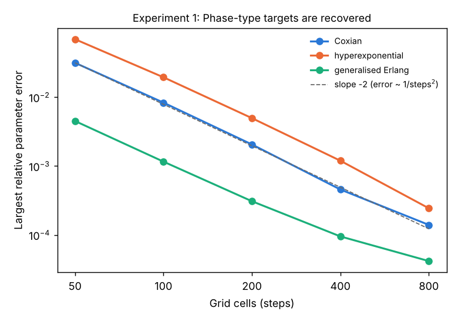

**Experiment 2.** Four target distributions that are not PH were approximated with 1 to 8 phases (Figure 2). The distance between the CDFs of the approximation and the target distribution decreased as the number of phases increased (Table 1 and Figure 3). The mean of every approximation was equal to the mean of the target distribution to within $10^{-15}$, as required at a fixed point of the EM algorithm, and no approximation had a squared coefficient of variation (SCV) below the PH bound $1/p$. Owing to this bound, the truncated normal distribution, with an SCV of 0.11, was the most difficult target distribution. For the other three target distributions, the distance ceased to decrease at $2$–$6 \cdot 10^{-3}$ with the default tolerance of $10^{-5}$. A tolerance of $10^{-7}$ reduced the distance to $0.7$–$4 \cdot 10^{-3}$, which shows that the accuracy was limited by the stopping rule rather than by the number of phases.

**Table 1.** Largest distance between the CDFs of the approximation and the target distribution by the number of phases $p$. SCV is the squared coefficient of variation of the target distribution.

| Target distribution     |  SCV | $p = 1$ | $p = 2$ |   $p = 4$ |   $p = 8$ | $p = 8$, tolerance $10^{-7}$ |
|:------------------------|-----:|--------:|--------:|----------:|----------:|-----------------------------:|
| log-normal (0, 0.5)     | 0.28 |   0.274 |   0.139 |    0.0296 |   0.00575 |                      0.00444 |
| Weibull (shape 1.5)     | 0.46 |   0.135 |  0.0190 |   0.00870 |   0.00244 |                      0.00105 |
| gamma (shape 2.5)       | 0.40 |   0.179 |  0.0411 |   0.00229 |   0.00218 |                     0.000664 |
| truncated normal (3, 1) | 0.11 |   0.337 |   0.227 |     0.126 |    0.0446 |                       0.0447 |

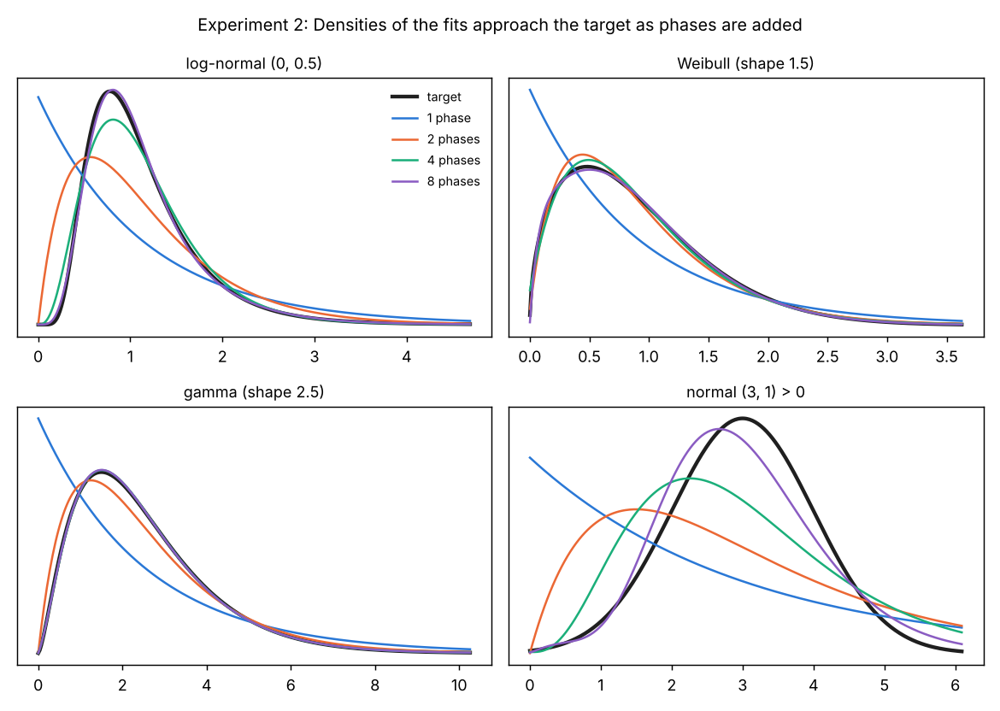

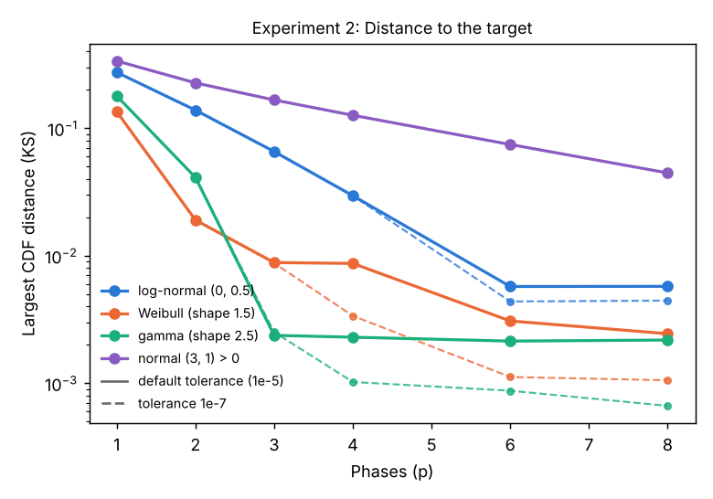

**Experiment 3.** The truncated normal target distribution with mean 10 and standard deviation 1 has an SCV of 0.01, far below $1/p$ for $p \le 32$. Since the Erlang distribution is the only PH distribution that attains the bound $\mathrm{SCV} = 1/p$ (Aldous and Shepp, 1987), the generalized Erlang approximation with $p$ phases should equal the Erlang distribution with all rates equal to $p/10$. Table 2 confirms this up to $p = 32$.

**Table 2.** Generalized Erlang approximations of the truncated normal distribution with mean 10 and standard deviation 1.

| Phases $p$ |      Mean | $p \cdot \mathrm{SCV}$ | Largest relative error of the rates |
|-----------:|----------:|-----------------------:|------------------------------------:|
|          2 | 10.000000 |               1.000000 |                $6.9 \cdot 10^{-16}$ |
|          4 | 10.000000 |               1.000000 |                $1.9 \cdot 10^{-14}$ |
|          8 | 10.000000 |               1.000000 |                $6.1 \cdot 10^{-14}$ |
|         16 | 10.000000 |               1.000000 |                $8.8 \cdot 10^{-14}$ |
|         32 | 10.000000 |               1.000000 |                $5.8 \cdot 10^{-13}$ |

**Conclusion.** The parameters of PH target distributions were recovered. Their error decreased at the second-order rate expected from the discretisation, and it became negligible on fine grids. For other target distributions, the approximation error decreased as the number of phases increased. Every approximation preserved the mean of the target distribution and respected the SCV bound $1/p$. Where theory requires the Erlang distribution, the approximation was the Erlang distribution. The only limitation was the default tolerance. With many phases, it terminated the slowly converging EM algorithm before the optimum, and a reduced tolerance remedied this.

## 4. Fitting phase-type distributions to observed data

The experiments are performed by `validation/fit_estimation.py`. `fit` fits continuous and discrete PH distributions to observed data with the EM algorithm. Each experiment simulated observations from a known PH distribution and compared the estimates with the true parameters or with an exact result.

**Experiments 1–3.** Observations were simulated from an exponential distribution with rate 0.5, also with 35% of the observations right-censored at independent times, and from a geometric distribution with a probability of 0.7 of staying in the phase. With one phase, the maximum likelihood estimate has a closed form, which `fit` reproduced to machine precision in all 4200 data sets (Table 3). For the exponential distribution, $2n\lambda/\hat\lambda$ follows the $\chi^2(2n)$ distribution exactly, and the simulated values were consistent with this distribution (Figure 4, Pearson test, $p = 0.13$). The mean estimates, $0.5253 \pm 0.0056$ for the rate and $0.6878 \pm 0.0026$ for the probability of staying, were consistent with their exact expectations of 0.5263 and 0.6893.

**Table 3.** Fits with one phase against their closed forms, where $n$ is the number of observations. The largest difference is relative for the rates and absolute for the probability.

| Distribution                |  $n$ | Data sets | Closed form           |  Largest difference  |
|:----------------------------|-----:|----------:|:----------------------|:--------------------:|
| Exponential                 |   20 |      2000 | $1/\bar y$            | $6.7 \cdot 10^{-16}$ |
| Exponential, right-censored |   50 |       200 | events / time at risk | $6.7 \cdot 10^{-16}$ |
| Geometric                   |   20 |      2000 | $1 - 1/\bar y$        | $1.1 \cdot 10^{-16}$ |

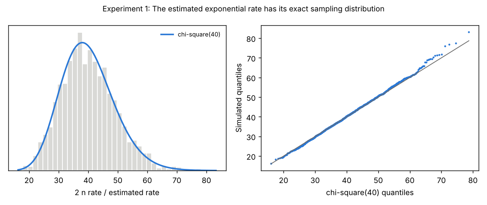

**Experiments 4 and 5.** Distributions with 2 phases were fitted to 200 data sets for each of $n = 100$, 300 and 1000 observations. The hyper-exponential distribution has a fast branch with probability 0.3 and rate 5 and a slow branch with rate 0.5. The generalized Erlang distribution has rates 1 and 3, and the discrete generalized Erlang distribution has probabilities 0.5 and 0.8 of staying in a phase. Since the parameters of a PH distribution are only identified up to a relabelling of the phases, they were compared in a fixed order, sorted by rate.

The bias decreased as $n$ increased (Table 4). At $n = 1000$, every bias was below 2% of the true value and far below the standard deviation of the estimates. The root-mean-square error decreased at least as fast as $1/\sqrt{n}$ (Figure 5). The fast rate of the hyper-exponential distribution was the most difficult parameter to estimate, with a bias of 18% at $n = 100$, where only approximately 30 observations originate from the fast branch. In all 1800 fits, the mean of the fitted distribution was equal to the sample mean to within $3 \cdot 10^{-15}$, as required at a fixed point of the EM algorithm. Three of the 600 hyper-exponential fits at $n = 100$ converged to a local maximum, identified by a log-likelihood below that of the true parameters, which is possible since `fit` uses a single random starting point.

**Table 4.** Bias of the estimates with 2 phases, with 95% intervals.

| Distribution                | Parameter        | Truth |      $n = 100$       |      $n = 300$       |      $n = 1000$      |
|:----------------------------|:-----------------|------:|:--------------------:|:--------------------:|:--------------------:|
| Hyper-exponential           | fast probability |   0.3 | $+0.0198 \pm 0.0159$ | $-0.0059 \pm 0.0083$ | $+0.0045 \pm 0.0041$ |
|                             | fast rate        |     5 | $+0.9090 \pm 0.4923$ | $+0.3409 \pm 0.2126$ | $-0.0241 \pm 0.0931$ |
|                             | slow rate        |   0.5 | $+0.0047 \pm 0.0115$ | $+0.0045 \pm 0.0063$ | $-0.0047 \pm 0.0033$ |
| Generalized Erlang          | slow rate        |     1 | $+0.1054 \pm 0.0342$ | $+0.0310 \pm 0.0194$ | $+0.0047 \pm 0.0078$ |
|                             | fast rate        |     3 | $+0.2093 \pm 0.2343$ | $+0.0257 \pm 0.1101$ | $+0.0462 \pm 0.0575$ |
| Discrete generalized Erlang | low staying      |   0.5 | $+0.0099 \pm 0.0219$ | $+0.0038 \pm 0.0136$ | $-0.0011 \pm 0.0071$ |
|                             | high staying     |   0.8 | $-0.0184 \pm 0.0062$ | $-0.0050 \pm 0.0033$ | $-0.0014 \pm 0.0014$ |

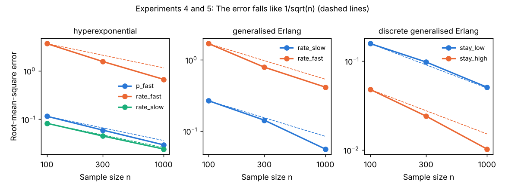

**Experiment 6.** The observations from the hyper-exponential distribution, $n = 1000$, were right-censored at independent exponential times with mean 4, left-censored at a detection limit of 0.1, or interval-censored between the points of a grid of width 0.2. Censoring increased the spread of the estimates (Figure 6) but introduced no noticeable bias. One of the twelve intervals in Table 5 excluded zero by a small margin, which is to be expected by chance. None of the fits converged to a local maximum.

**Table 5.** Bias of the hyper-exponential estimates with censored observations, $n = 1000$, 100 data sets per type of censoring.

| Observations      | Proportion censored |   Fast probability   |      Fast rate       |      Slow rate       |
|:------------------|--------------------:|:--------------------:|:--------------------:|:--------------------:|
| Uncensored        |                0.00 | $+0.0038 \pm 0.0051$ | $-0.0622 \pm 0.1156$ | $+0.0004 \pm 0.0043$ |
| Right-censored    |                0.25 | $+0.0031 \pm 0.0059$ | $+0.0608 \pm 0.1315$ | $+0.0016 \pm 0.0058$ |
| Left-censored     |                0.15 | $+0.0070 \pm 0.0068$ | $-0.0333 \pm 0.1405$ | $+0.0011 \pm 0.0050$ |
| Interval-censored |                1.00 | $0.0000 \pm 0.0051$  | $+0.0971 \pm 0.1431$ | $-0.0026 \pm 0.0043$ |

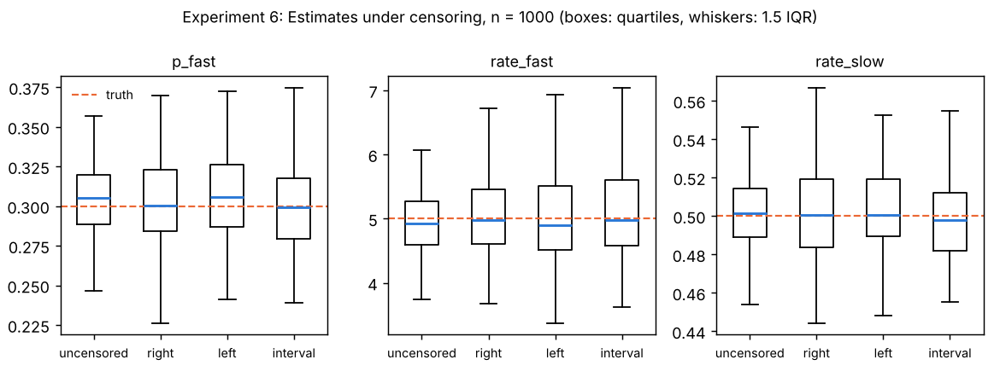

**Conclusion.** `fit` reproduced the closed-form estimates for one phase to machine precision. With two phases, the estimates were consistent. Their bias and root-mean-square error decreased as the number of observations increased, and the fitted mean equalled the sample mean in every fit. Censoring increased the variance of the estimates, but it did not introduce bias. The only deviation was that 0.5% of the hyper-exponential fits at $n = 100$ converged to a local maximum. This is a known property of the EM algorithm, and it can be mitigated by repeating the fit from several random starting points.

## 5. Fitting a phase-type regression

The experiments are performed by `validation/fitreg_estimation.py`. The data were simulated from the phase-type regression of Bladt (2022), $Y \mid x, z \sim \mathrm{PH}(\pi, e^{\eta} T)$ with $\eta = \beta_x x + \beta_z z$, where $\mathrm{PH}(\pi, T)$ is the baseline phase-type distribution, $x \sim N(0, 1)$ is a continuous covariate, $z$ is a balanced binary covariate, $\beta_x = 0.8$ and $\beta_z = -0.5$. The settings were

- an exponential baseline distribution with $n = 50$, 200 and 1000 observations, 400 data sets each,
- a Coxian baseline distribution with $n = 100$ and 300 observations, fitted with the defaults of `fitreg`, 100 data sets each,
- right-censored observations at $n = 200$ (33% censored on average), 300 data sets,
- a random intercept, $\eta = \beta_x x + \beta_z z + b$ with $b \sim N(0, \sigma^2)$, $\sigma = 0.5$ and 20 groups of 10 observations, 300 data sets.

The standard deviation of the estimated coefficients (SD) agreed with the mean reported standard error (SE), with ratios between 0.90 and 1.05 (Table 6), and the z-statistics were close to standard normal (Figure 7). Two of the fourteen bias intervals excluded zero, $\beta_x$ with the Coxian baseline distribution at $n = 100$ ($+0.031 \pm 0.024$, 4% of the true value, negligible at $n = 300$) and $\beta_x$ with right-censored observations ($+0.011 \pm 0.010$, 1.4% of the true value). With the exponential baseline distribution, $\sqrt{n}$ times the root-mean-square error remained close to 1.0 for $\beta_x$ and 2.0 for $\beta_z$ (Figure 8).

The mean estimate of the standard deviation of the random effect was $0.465 \pm 0.014$, 7% below the true value. This corresponds to the known downward bias of maximum likelihood estimates of variance components with few groups. The mean reported SE of the estimate (0.114) was slightly below the SD of the estimates (0.127).

**Table 6.** Bias, SD and mean SE of the estimated coefficients.

| Setting                      | Coefficient |    Bias with 95% CI   |     SD |  Mean SE | SD / SE |
|:-----------------------------|:-----------:|:--------------------:|-------:|---------:|--------:|
| Exponential, $n = 50$        | $\beta_x$   | $+0.0071 \pm 0.0154$ | 0.1565 |   0.1520 |    1.03 |
|                              | $\beta_z$   | $+0.0171 \pm 0.0290$ | 0.2947 |   0.2887 |    1.02 |
| Exponential, $n = 200$       | $\beta_x$   | $+0.0004 \pm 0.0073$ | 0.0745 |   0.0724 |    1.03 |
|                              | $\beta_z$   | $+0.0060 \pm 0.0133$ | 0.1354 |   0.1421 |    0.95 |
| Exponential, $n = 1000$      | $\beta_x$   | $+0.0006 \pm 0.0030$ | 0.0308 |   0.0316 |    0.97 |
|                              | $\beta_z$   | $-0.0005 \pm 0.0062$ | 0.0631 |   0.0633 |    1.00 |
| Coxian, $n = 100$            | $\beta_x$   | $+0.0314 \pm 0.0237$ | 0.1196 |   0.1235 |    0.97 |
|                              | $\beta_z$   | $-0.0347 \pm 0.0497$ | 0.2503 |   0.2390 |    1.05 |
| Coxian, $n = 300$            | $\beta_x$   | $+0.0057 \pm 0.0123$ | 0.0621 |   0.0690 |    0.90 |
|                              | $\beta_z$   | $-0.0045 \pm 0.0275$ | 0.1387 |   0.1371 |    1.01 |
| Right-censored, $n = 200$    | $\beta_x$   | $+0.0110 \pm 0.0104$ | 0.0914 |   0.0924 |    0.99 |
|                              | $\beta_z$   | $-0.0051 \pm 0.0200$ | 0.1756 |   0.1740 |    1.01 |
| Random intercept             | $\beta_x$   | $-0.0008 \pm 0.0083$ | 0.0728 |   0.0769 |    0.95 |
|                              | $\beta_z$   | $-0.0024 \pm 0.0178$ | 0.1566 |   0.1517 |    1.03 |

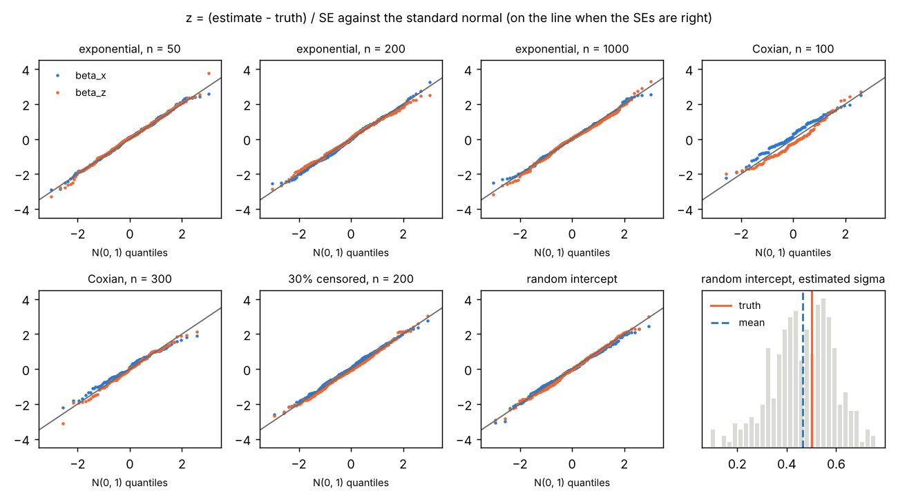

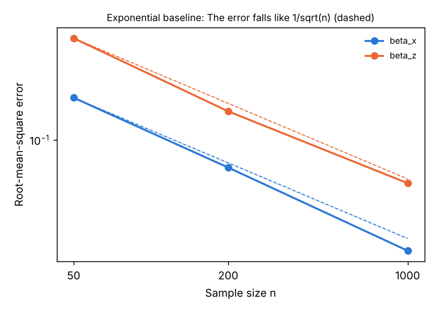

**Conclusion.** The estimated coefficients showed only small finite-sample biases, and their root-mean-square errors decreased at the rate $1/\sqrt{n}$. The reported standard errors agreed with the observed variation of the estimates in all settings, including right-censored observations and a random intercept. The standard deviation of the random effect was underestimated by 7%. This is the downward bias expected for maximum likelihood with 20 groups.

## 6. Tests and confidence intervals of a phase-type regression

The experiments are performed by `validation/fitreg_tests.py`. The data were simulated from the phase-type regression of Section 5 with $\beta_x = 0.8$ and varying values of $\beta_z$.

**Experiment 1.** Under the true null hypothesis $\beta_z = 0$, the rejection rate of the likelihood-ratio test of the coefficient (`coeftest`) was consistent with the nominal level in all five settings. The same applied to the likelihood-ratio test of a categorical variable with three levels and no effect (`getlrtest`, 2 degrees of freedom, Table 7). The p-values were uniformly distributed (Figure 9). The 95% profile-likelihood confidence interval of $\beta_x$, the default of `confint`, contained the true value in 93% to 96% of the data sets, as did the Wald interval (Figure 10).

**Table 7.** Rejection rates of likelihood-ratio tests of true null hypotheses with 95% intervals. KS is the p-value of the Kolmogorov–Smirnov test of uniform p-values.

| Setting                   | Data sets |       Level 1%       |       Level 5%       |      Level 10%       |   KS |
|:--------------------------|----------:|:--------------------:|:--------------------:|:--------------------:|-----:|
| Exponential, $n = 50$     |       400 | 0.003 [0.000, 0.014] | 0.030 [0.016, 0.052] | 0.087 [0.062, 0.120] | 0.62 |
| Exponential, $n = 200$    |       400 | 0.018 [0.007, 0.036] | 0.048 [0.029, 0.073] | 0.098 [0.070, 0.131] | 0.70 |
| Coxian, $n = 100$         |       100 | 0.000 [0.000, 0.036] | 0.010 [0.000, 0.054] | 0.100 [0.049, 0.176] | 0.25 |
| Right-censored, $n = 200$ |       300 | 0.010 [0.002, 0.029] | 0.060 [0.036, 0.093] | 0.093 [0.063, 0.132] | 0.26 |
| Random intercept          |       300 | 0.013 [0.004, 0.034] | 0.047 [0.026, 0.077] | 0.103 [0.071, 0.143] | 0.66 |
| Categorical, $n = 200$    |       400 | 0.010 [0.003, 0.025] | 0.043 [0.025, 0.067] | 0.087 [0.062, 0.120] | 0.45 |

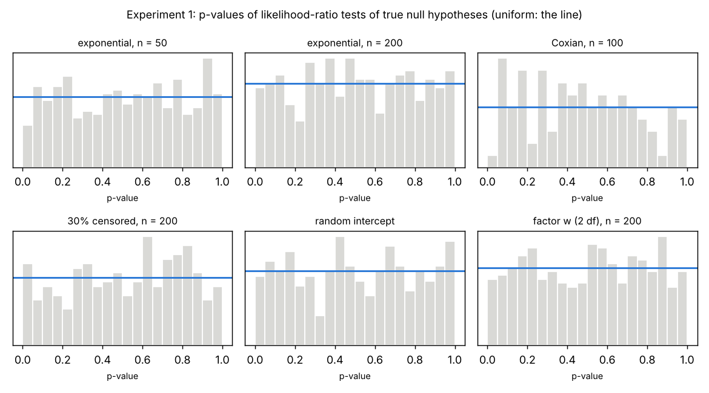

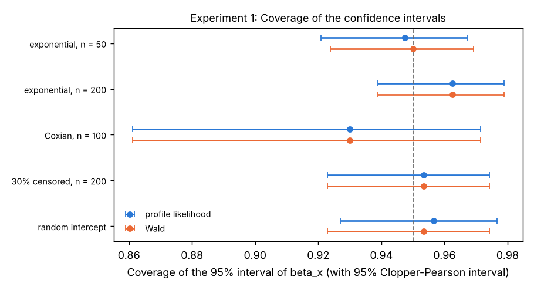

**Experiment 2.** At $n = 200$, the simulated power of the likelihood-ratio test of $\beta_z$ agreed with the asymptotic power derived from the noncentral $\chi^2(1)$ distribution with noncentrality $n\beta_z^2/4$, for $\beta_z$ from 0 to 0.5 (Figure 11).

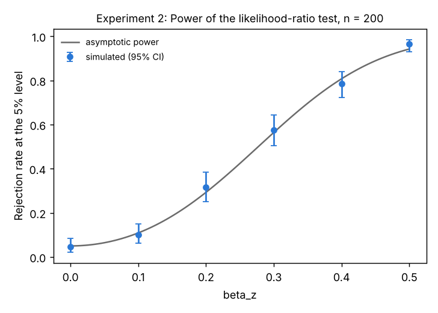

**Experiment 3.** Without a random effect ($\sigma = 0$), the score test of the standard deviation of the random effect, the default of `getsigmatest`, led to a rejection of the null hypothesis in 5.8% of the data sets at the 5% level, and its p-values were uniformly distributed (Kolmogorov–Smirnov test, $p = 0.97$). The likelihood-ratio test led to a rejection in 3.0% of the data sets and was thus slightly conservative with 20 groups. The power of both tests increased with $\sigma$ to approximately 95% at $\sigma = 0.5$ (Table 8 and Figure 12).

**Table 8.** Rejection rates of the tests of $\sigma = 0$ at the 5% level with 95% intervals, 20 groups of 10 observations.

| True $\sigma$ | Data sets | Score test (default) |   Likelihood ratio   |
|--------------:|----------:|:--------------------:|:--------------------:|
|           0.0 |       400 | 0.058 [0.037, 0.085] | 0.030 [0.016, 0.052] |
|           0.1 |       200 | 0.075 [0.043, 0.121] | 0.055 [0.028, 0.096] |
|           0.2 |       200 | 0.265 [0.205, 0.332] | 0.225 [0.169, 0.289] |
|           0.3 |       200 | 0.565 [0.493, 0.635] | 0.585 [0.513, 0.654] |
|           0.5 |       200 | 0.945 [0.904, 0.972] | 0.960 [0.923, 0.983] |

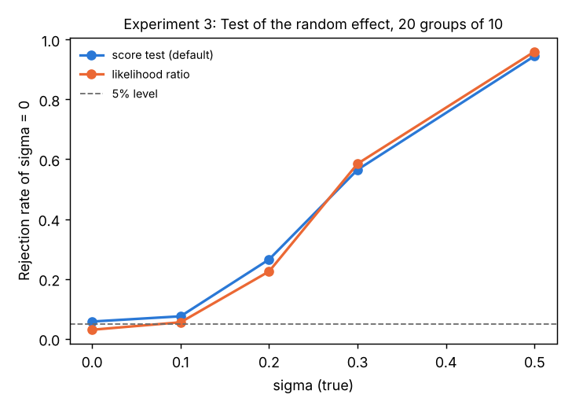

**Experiment 4.** `confint(sigma=True)` adds a scaled chi-square confidence interval of the standard deviation of the random effect with $f = \hat\sigma^2 / (2\,\mathrm{SE}^2)$ degrees of freedom. Table 9 shows the coverage of the interval for the fits of Experiment 3. At $\sigma = 0.5$, with a median $f$ of 9, the coverage was 97%. At small values of $\sigma$, the data contain little information about $\sigma$, and in nearly all fits either the data did not support the random effect or $f$ was below 4, 98% at $\sigma = 0.1$ and 88% at $\sigma = 0.2$. The few fits with $f \ge 4$ at these values were those that overestimated $\sigma$, since $f$ increases with $\hat\sigma$, and their intervals therefore tended to lie above the true value. Hence, $f \ge 4$ does not ensure the nominal coverage when $\sigma$ is small. With $\sigma = 0$, the data did not support the random effect in 64% of the fits and resulted in $f < 4$ in a further 35%.

**Table 9.** Coverage of the 95% scaled chi-square confidence interval of $\sigma$ with 95% intervals. In the first coverage column, a fit where the data did not support the random effect is counted as a miss, the second column includes only fits with an interval, and the third only fits with $f \ge 4$. The last two columns are the proportions of fits with $f < 4$ and of fits where the data did not support the random effect.

| True $\sigma$ | Median $f$ | Coverage, all fits   | Coverage, intervals  | Coverage, $f \ge 4$  | $f < 4$ | No support |
|--------------:|-----------:|:--------------------:|:--------------------:|:--------------------:|--------:|-----------:|
|           0.1 |        0.7 | 0.325 [0.261, 0.395] | 0.730 [0.626, 0.819] | 0.000 [0.000, 0.602] |    0.42 |       0.56 |
|           0.2 |        1.9 | 0.615 [0.544, 0.683] | 0.885 [0.820, 0.933] | 0.348 [0.164, 0.573] |    0.58 |       0.30 |
|           0.3 |        3.6 | 0.845 [0.787, 0.892] | 0.904 [0.852, 0.942] | 0.810 [0.709, 0.887] |    0.52 |       0.07 |
|           0.5 |        9.0 | 0.970 [0.936, 0.989] | 0.970 [0.936, 0.989] | 0.967 [0.930, 0.988] |    0.09 |       0.00 |

**Conclusion.** The likelihood-ratio tests held their nominal level, and their power agreed with asymptotic theory. The profile-likelihood confidence intervals attained their nominal coverage. The score test of the random effect held its level with 20 groups, whereas the likelihood-ratio test was slightly conservative, as expected. The scaled chi-square interval of the standard deviation of the random effect attained its nominal coverage when the standard deviation was well determined by the data. A small $f$ reliably indicated when it was not. However, when the standard deviation is small relative to the information in the data, the interval may undercover, also for fits with $f \ge 4$.

## References

Aldous, D., and Shepp, L. (1987). The least variable phase type distribution is Erlang. *Stochastic Models*, 3(3), 467–473.

Bladt, M. (2022). Phase-type distributions for claim severity regression modeling. *ASTIN Bulletin*, 52(2), 417–448.

Bladt, M., and Nielsen, B. F. (2017). *Matrix-Exponential Distributions in Applied Probability*. Springer.

---

*The simulations were run on 3 November 2026 with PhaseDist 0.3.0.*
